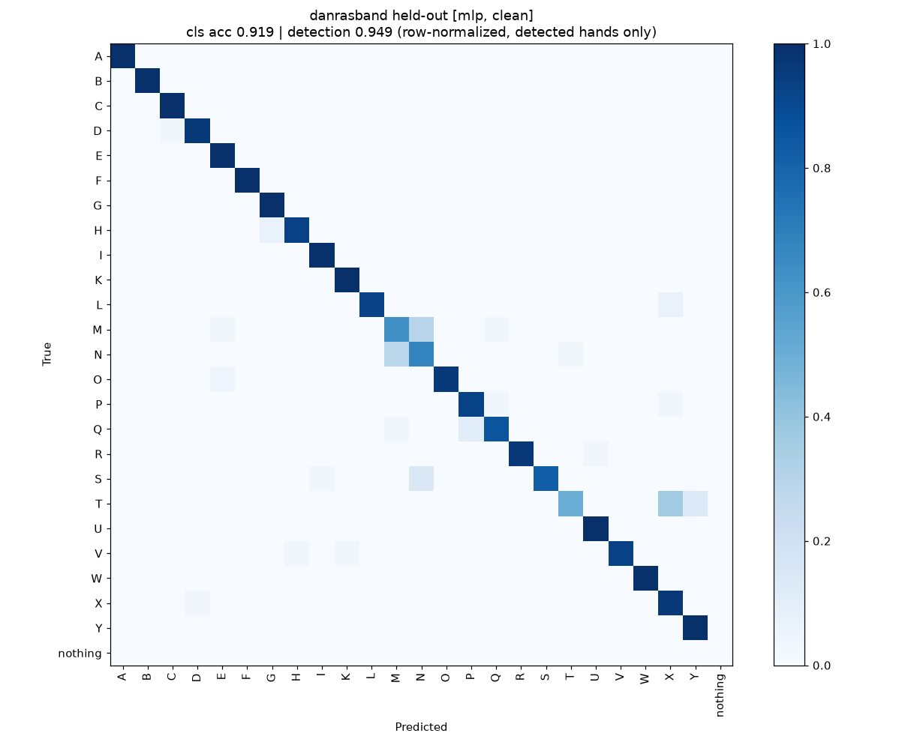

# Hand Sign Detector

A Python tool that recognises **24 static American Sign Language (ASL) fingerspelling letters** (A–Y, without J and Z) from single images or a webcam. It finds the hand with MediaPipe, turns the 21 hand landmarks into a normalised 63-number feature vector, and classifies that vector with a small neural network (MLP). A random forest is trained alongside as a baseline.

On a held-out test set that the models never saw during training, the MLP labels **91.95%** of letter images correctly when a hand is found. On test data from sources it was not trained on, accuracy falls to between 63% and 84%. Both numbers are reported below, because the second is the better guide to how the model behaves on new people and new cameras.

> **Status:** v1 prototype, built and evaluated locally. J and Z involve motion and are planned for v2. `webcam.py` and `collect.py` have not yet been tested with a real camera.

## Contents

- [How it works](#how-it-works)
- [Setup](#setup)
- [Usage](#usage)
- [Results](#results)
- [Limitations](#limitations)
- [Data](#data)
- [Roadmap](#roadmap)
- [Background and references](#background-and-references)
- [License](#license)

## How it works

The pipeline has three stages: landmark extraction, normalisation, and classification. The classifier never sees pixels, only the geometry of the hand.

**1. Landmarks** (`src/hand_sign_detector/landmarks.py`). The MediaPipe Tasks `HandLandmarker` returns 21 3-D points for the most confident hand in the image (`num_hands: 1`, detection, presence and tracking confidence 0.5, from `config.yaml`). Images are passed in exactly as captured and are never mirrored. `webcam.py` flips the frame only for display, after detection, so training and live use follow the same convention.

**2. Normalisation** (`normalize_landmarks`). Each hand becomes a 63-dimensional vector (x, y, z for 21 points):

1. MediaPipe's image-relative coordinates are converted to pixel-aspect units (x × width, y × height, z × width), so non-square images are not stretched.
2. The wrist (landmark 0) is moved to the origin.
3. All coordinates are divided by the palm size, defined as the 3-D distance from the wrist to the middle-finger MCP joint (landmark 9). This removes the effect of hand size and distance from the camera.
4. Hands that MediaPipe labels `Left` are mirrored (x → −x) into a canonical right hand. Hands with unknown handedness are left unchanged.
5. The features are deliberately **not** rotation-normalised, because some letter pairs (H/U, G/Q, K/P) differ mainly in orientation.

Landmarks that are not finite, or whose palm size is close to zero, are rejected and treated as "no hand".

**3. Classification** (`src/hand_sign_detector/models.py`). The main model is a scikit-learn `MLPClassifier` with two hidden layers (128 and 64 units), L2 penalty `alpha = 1e-4`, up to 200 iterations and early stopping, applied after a `StandardScaler`. The baseline is a `RandomForestClassifier` with 300 trees. Both use seed 42.

**Inference** (`src/hand_sign_detector/inference.py`). A prediction is shown as `Uncertain` when the top class probability is below 0.60. The webcam app smooths labels with a majority vote over the last 10 frames and always displays the top two candidates with their probabilities. When MediaPipe finds no hand, the output is `nothing`.

## Setup

Python **3.11 or newer** is required (`requires-python = ">=3.11"` in `pyproject.toml`). The pinned NumPy 2.4 no longer supports Python 3.10.

```bash
git clone https://github.com/Navid-A-08/hand-sign-detector.git
cd hand-sign-detector
python -m venv .venv && source .venv/bin/activate
pip install -r requirements.txt
python prepare_data.py --model-only   # downloads models/hand_landmarker.task (~7.8 MB)
```

The versions in `requirements.txt` are pinned and were checked to install together in fresh Python 3.11 environments on Linux x86_64. MediaPipe depends on `opencv-contrib-python`, so do **not** also install `opencv-python`: both provide the same `cv2` package and whichever is installed last wins.

Datasets, extracted landmarks and trained models are not stored in the repository (see `.gitignore`). To use `predict_image.py` or `webcam.py`, first run `prepare_data.py` and `train.py` as described below.

## Usage

All scripts read `config.yaml` from the repository root; pass `--config path/to/other.yaml` to use another file.

### `prepare_data.py`: download datasets and extract landmarks

```bash
python prepare_data.py                 # download all sources, extract landmarks
python prepare_data.py --model-only    # only fetch hand_landmarker.task
python prepare_data.py --workers 8     # parallel landmark extraction (default 4)
python prepare_data.py --limit 200     # at most ~200 images per image source, for quick tests (0 = all)
```

Downloads the Kaggle sources with `kagglehub` and ASLNow! with `huggingface_hub` (a source that fails to download is logged and skipped), removes held-out copies and duplicates (see [Data](#data)), runs the landmarker, and writes one table per source to `data/landmarks/*.parquet` plus a summary to `reports/data_summary.json`.

### `train.py`: cross-validate and fit the models

```bash
python train.py                         # default: GPL grassknoted subset excluded
python train.py --include-gpl           # ablation that also trains on grassknoted
python train.py --skip-cv               # fit the final models only
python train.py --exclude sau_numeric --tag clean_no_sau_numeric   # sensitivity check
```

Runs leave-one-source-out cross-validation and a random-split reference, then fits the MLP and the random forest on all training sources. Models are saved as `models/<model>_<tag>.joblib` and results as `reports/<tag>/train_summary.json` with confusion matrices in `reports/<tag>/confusion/`. The tag defaults to `clean`, or `with_gpl` with `--include-gpl`. The danrasband test set is never used here.

### `evaluate.py`: score the held-out test set

```bash
python evaluate.py                       # clean models
python evaluate.py --tag with_gpl        # ablation models
python evaluate.py --models mlp          # one model only (default: mlp random_forest)
```

Writes `reports/<tag>/danrasband_metrics.json` and confusion matrices (PNG and CSV).

### `predict_image.py`: classify single images

```bash
python predict_image.py photo1.jpg photo2.jpg
python predict_image.py photo.jpg --annotate out/          # also save annotated copies
python predict_image.py photo.jpg --model models/random_forest_clean.joblib
```

Prints one JSON line per image with `image`, `hand_detected`, `handedness`, `label`, `confidence` and `top_k` (the two most likely letters). The default model is `models/mlp_clean.joblib`. With `--annotate`, the landmark skeleton and the top-2 text are drawn onto a copy of each image.

### `webcam.py`: live recognition

```bash
python webcam.py                 # camera 0, default MLP
python webcam.py --camera 1 --model models/random_forest_clean.joblib
```

Shows the smoothed label, the top-2 candidates and the frame rate in a mirrored (selfie) window. Press `q` or `Esc` to quit. Not yet tested with a real camera.

### `collect.py`: record your own labelled landmarks

```bash
python collect.py --signer navid
python collect.py --signer guest01 --camera 1 --every 3
```

`--signer` is required (1–32 letters, digits, `_` or `-`). `--every N` keeps every Nth frame while recording (default 2). Keys: `a`–`y` choose the letter (`j` and `z` are ignored in v1), `0` chooses `nothing` (hand visible but not signing), `space` starts or stops recording, `Esc` saves and quits. Each session is saved as `data/landmarks/webcam_<signer>_<session>.parquet` with the same schema as the dataset tables, so `train.py` picks it up automatically as source `webcam`. Not yet tested with a real camera.

### Tests

```bash
pytest
```

The MediaPipe integration test (`tests/test_mediapipe_integration.py`) checks the flip and handedness convention on real images and is skipped when the landmarker model or the danrasband images are not available locally.

## Results

All numbers come from `reports/` and were produced by the default (`clean`) configuration unless stated otherwise. **Detection rate** (did MediaPipe find a hand?) is reported separately from **classification accuracy** (was the letter right, given that a hand was found?). **End-to-end accuracy** counts every image, with "no hand found" scored as a `nothing` prediction.

### Held-out test: danrasband ASL Alphabet Test

750 images (30 per class for 24 letters and `nothing`), collected against a variety of backgrounds as an out-of-domain check. The test images are never used for training, and their copies and detected near-duplicates are removed from the training data (see [Data hygiene](#data-hygiene)). MediaPipe found a hand in 683 of the 720 letter images (**94.86%**) and in none of the 30 `nothing` images.

| Model | Classification accuracy (683 detected hands) | Macro-F1 | End-to-end accuracy (750 images) |
|---|---|---|---|
| **MLP** | **91.95%** | **0.918** | **87.73%** |
| Random forest | 89.31% | 0.892 | 85.33% |

The end-to-end figure includes the 30 `nothing` images, which count as correct because no hand was detected in them. It does not show that the model can recognise "no sign"; see [Limitations](#limitations).



*Row-normalised confusion matrix of the MLP on the danrasband test set, detected hands only. The CSV version is in `reports/clean/confusion/danrasband_mlp.csv`.*

Most errors fall in a small group of letters that differ mainly in thumb position. The most frequent MLP confusions are:

| True → predicted | Count | Share of that letter's detected images |
|---|---|---|
| T → X | 11 | 36.7% |
| M → N | 8 | 29.6% |
| N → M | 8 | 28.6% |
| S → N | 4 | 14.3% |
| T → Y | 4 | 13.3% |

Per-letter accuracy is lowest for T (50.0%), M (63.0%), N (67.9%) and S (82.1%). Eleven letters (A, B, C, E, F, G, I, K, U, W, Y) are classified without error. This matches the pattern reported for the Surrey dataset, where letters such as A/E/M/S/T "differ only by the thumb position" [5].

### Leave-one-source-out cross-validation

None of the training sources records signer IDs, so a true signer-disjoint split is not possible. Instead, each training source in turn is held out, the models are trained on the remaining sources, and the held-out source is scored. This is a stricter test than a random split, because the model has to generalise to a different collection setup.

| Held-out source | Detection rate | MLP accuracy | RF accuracy | MLP end-to-end |
|---|---|---|---|---|
| aslnow | 100%* | 69.74% | 68.57% | 69.74% |
| borisgraudt | 100%* | 76.63% | 67.92% | 76.63% |
| sau_numeric | 98.04% | 83.53% | 82.42% | 81.89% |
| sau_paren | 29.23% | 78.36% | 73.85% | 22.91% |
| sau_rotate | 48.26% | 63.27% | 50.66% | 30.54% |

\* These sources are distributed as landmarks only, so every sample already has a hand.

MLP classification accuracy ranges from **63% to 84%** across held-out sources, and the random forest from 51% to 82%. Low detection rates on `sau_paren` and `sau_rotate` mean that end-to-end accuracy on those sources is far lower than classification accuracy. Which of these numbers best predicts webcam performance for a new signer is not yet known.

### Random split (for comparison only)

A stratified random 80/20 split of the detected training samples (6,649 test samples) gives **97.92%** for the MLP and 97.23% for the random forest. This is 14–35 points above the leave-one-source-out results and about 6 points above the held-out test. The likely reason is that many sources are bursts of frames from continuous recording, so near-identical frames end up in both training and test sets. The reports do not measure this directly, so the random-split figure should not be quoted as the model's accuracy.

### Ablations on the held-out test

| Configuration | Report | MLP accuracy | RF accuracy |
|---|---|---|---|
| Default (`clean`) | `reports/clean/` | 91.95% | 89.31% |
| Without `sau_numeric` | `reports/clean_no_sau_numeric/` | 88.43% | 83.16% |
| Plus GPL grassknoted set | `reports/with_gpl/` | 92.97% | 92.83% |

Adding the GPL-2 grassknoted images raises held-out accuracy by about one point for the MLP and three and a half points for the random forest. They are excluded by default for licensing reasons (see [Data](#data)). Removing `sau_numeric`, the source in which the near-duplicates of the test set were found, lowers accuracy by about 3.5 points. This run cannot separate the effect of leftover similarity to the test set from the simple loss of 7,558 training samples.

## Limitations

- **No signer-disjoint evaluation.** None of the sources provides signer IDs, so the evaluation is source-disjoint, not signer-disjoint. How well the model works for a new person is the most important unknown. Recording several signers with `collect.py` is the highest-value next step.
- **Thumb-position letters are weak.** T, M, N and S account for most of the held-out errors (see the confusion table). Landmark geometry alone may not separate them reliably.
- **Overconfidence.** Most of the MLP's mistakes on the held-out set still have a top probability above the 0.60 threshold, so `Uncertain` does not catch them. The top-2 display is the main safeguard for now.
- **No trained `nothing` class.** The clean training sources contain no `nothing` samples, so the models only know the 24 letters. `nothing` currently means "no hand detected"; a hand that is visible but not signing will still be given a letter.
- **Detection failures.** MediaPipe missed the hand in 5.14% of held-out letter images and in most `sau_paren` and `sau_rotate` images. The classifier cannot recover these.
- **Landmark-only sources are not fully normalised.** borisgraudt and ASLNow! do not record handedness or image size, so their samples cannot be mirrored or aspect-corrected like the image sources.
- **Live apps untested.** `webcam.py` and `collect.py` have not been run against a real camera, so there are no live accuracy or frame-rate numbers yet.
- **J and Z are not supported.** Both letters involve motion and need a sequence model.
- **Small test set.** The held-out set has about 28 detected images per letter, so a single error changes a letter's accuracy by 3–4 points.

## Data

The datasets are not included in this repository. `prepare_data.py` downloads them, and each keeps its own license. The licenses below are those stated on each dataset page at the time of the project's research (November 2026); please check them before reusing the data.

| Source | Used for | License (as stated by the source) | Samples kept (hand detected) |
|---|---|---|---|
| [ASL Alphabet Test](https://www.kaggle.com/datasets/danrasband/asl-alphabet-test) (danrasband) | **held-out test only** | CC0 | 750 images (683 letter images with a hand) |
| [ASL (American Sign Language) Alphabet Dataset](https://www.kaggle.com/datasets/debashishsau/aslamerican-sign-language-aplhabet-dataset) (Debashish Sau), non-grassknoted parts | training | CC0, as stated by the compiler | 45,073 images (21,668) |
| [ASL Alphabet Hand Landmarks](https://www.kaggle.com/datasets/borisgraudt/asl-alphabet-hand-landmarks) (borisgraudt) | training | CC0 | 9,703 landmark sets |
| [ASLNow!](https://huggingface.co/datasets/sid220/asl-now-fingerspelling) (sid220) | training | MIT | 1,874 landmark sets |
| [ASL Alphabet](https://www.kaggle.com/datasets/grassknoted/asl-alphabet) (grassknoted), found inside Sau | **excluded by default**; ablation only (`--include-gpl`) | GPL-2.0 | 75,000 images (55,369) |

The Sau compilation is split by file-name pattern into three training sources: `sau_numeric` (7,709 images, 7,558 with a hand), `sau_paren` (20,614, 6,026) and `sau_rotate` (16,750, 8,084).

### Data hygiene

The Sau dataset pools several other datasets, and checking it revealed that it contains the test set. Without the steps below, test images would have leaked into training and inflated the held-out score. `prepare_data.py` therefore:

- drops the **750** copies of danrasband test images found inside Sau by file name (a further check by file hash found no renamed copies);
- drops **709** further Sau images (all in `sau_numeric`) that are near-duplicates of danrasband test images, detected by comparing 32×32 greyscale thumbnails (1 − Pearson correlation below 0.1);
- re-attributes **71,970** Sau files that are byte-identical to grassknoted images to the grassknoted source, so they are excluded with it;
- drops **752** exact duplicates within Sau.

The counts are recorded in `reports/data_summary.json` under `sau_drops`.

### Credits

Thanks to the creators of the datasets above (danrasband, Debashish Sau, borisgraudt, sid220 and grassknoted) and to Google for [MediaPipe Hand Landmarker](https://ai.google.dev/edge/mediapipe/solutions/vision/hand_landmarker).

## Roadmap

1. **More signers.** Record several people with `collect.py` and run a genuine leave-one-signer-out evaluation. This matters more than any change of model.
2. **J and Z.** Keep a rolling buffer of about 20–30 frames of landmarks, trigger on the starting handshape (I for J, D for Z) plus fingertip movement, and classify the trajectory with a simple rule or a small GRU/LSTM.
3. **A CNN for the hard letters.** Crop the hand with MediaPipe and run a small image model only for the thumb-position group (A, E, M, N, S, T), where landmarks alone are weakest. Published evidence on whether this helps is mixed [1, 3].
4. **A real `nothing` class** from recorded hands that are visible but not signing.
5. **Live testing and calibration.** Test `webcam.py` with real cameras, and calibrate the MLP's probabilities so that the `Uncertain` threshold catches more of its errors.

## Background and references

The design choices (landmarks rather than raw pixels, a source- or signer-disjoint split, a separate detection rate, a confidence threshold with top-2 display) follow the project's literature review. The main points:

- Random-split scores near 99% are common but uninformative. In one student comparison, models scoring 97–100% on random splits reached only 26.7–64.9% on live webcam input, with MediaPipe landmarks plus a classifier doing best [1]. MediaPipe features with an SVM reach 87.6–99.4% on random 80/20 splits of three datasets [4]. Signer-disjoint results reported elsewhere are lower, 83.5% [6] and 92.2% [7], and come from student and non-peer-reviewed projects.
- The MediaPipe Tasks documentation states that handedness refers to the subject's hands and that mirroring the image inverts it [2]; the project tests this convention directly (`tests/test_mediapipe_integration.py`).
- Thumb-position letters are a known difficulty: Pugeault and Bowden report confusion among a/e/m/s and only 37% precision for t [5].

[1] Stanford CS231n student final report comparing YOLO and MediaPipe + MLP for ASL letters. https://cs231n.stanford.edu/papers/text_file_840589357-CS_231N_Final_Report%20(2).pdf  
[2] Google AI Edge, MediaPipe Hand Landmarker documentation. https://ai.google.dev/edge/mediapipe/solutions/vision/hand_landmarker  
[3] Student project paper on ASL alphabet recognition, IRJMETS. https://www.irjmets.com/upload_newfiles/irjmets80900042156/paper_file/irjmets80900042156.pdf  
[4] Shin et al. (2021), *Sensors*: MediaPipe hand features with an SVM for ASL letters. https://pmc.ncbi.nlm.nih.gov/articles/PMC8434249/  
[5] Pugeault, N. and Bowden, R. (2011), ASL fingerspelling recognition on the Surrey dataset. http://pugeault.online.fr/publications/PugeaultBowden2011b.pdf  
[6] Student final project, NBI Applied ML course (2023), reading the ASL alphabet with ML. https://www.nbi.dk/~petersen/Teaching/ML2023/Week8/FinalProject08_MortenLudvigMichelleEmilie_UsingMLtoReadTheASLAlphabet.pdf  
[7] SignSpeak project page (personal portfolio, not peer reviewed). https://www.mayank-goel.com/projects/signspeak.html  

## License

The code is released under the [MIT License](LICENSE). The datasets are not included and keep their own licenses (see [Data](#data)).
